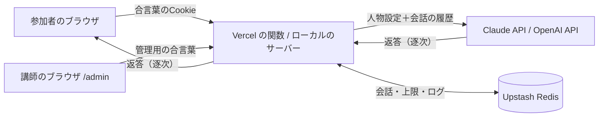

# 模擬ヒアリング チャットツール

AI要件定義ハンズオンで、参加者が「要望を出したB社の担当者（山田さん）」と「チケットを起票したCS（佐藤さん）」にヒアリングできる簡易チャットです。資料に書かれていないことを、自分で聞き出す練習に使います。

- サーバー: Node.js 22.9 以上 / TypeScript / [Hono](https://hono.dev)
- 画面: 素のHTML・CSS・JavaScript（`pages/`。ビルド時にTypeScriptへ埋め込み、サーバーのルートから返す）
- AI: Claude（`@anthropic-ai/sdk`）または OpenAI（`openai`）。環境変数で切り替え
- 逐次表示: Server-Sent Events
- 動かす場所: **Vercel**（手元のPCでも動く）



## 守っていること

| 原則 | どう実現しているか |
|---|---|
| APIキーをブラウザに渡さない | キーはサーバーの環境変数だけ。ブラウザが通信するのは自分のサーバーだけ |
| 人物設定に、ハンズオンの答えを書かない | `personas/*.md` に答え（最終仕様）は書いていない |
| 人物設定をブラウザに返さない | `GET /api/personas` は ID・表示名・説明だけを返す（テストで確認） |
| 会話の履歴はサーバーが持つ | ブラウザは今回の発言だけを送る。履歴や人物設定を送っても無視される |
| 使える量に上限 | 往復の上限・1日のトークン上限・講師の停止ボタン・合言葉の総当たり対策 |
| ログを残し、参加者にも伝える | 発言と返答を1行ずつ記録。画面に「講師が確認します」と常時表示 |

## ローカルで動かす

```bash
pnpm install
cp .env.example .env     # AI_PROVIDER・キー・ACCESS_CODE・ADMIN_CODE を入れる
pnpm dev                 # http://localhost:3000/ （講師の画面は /admin）
```

APIキーなしで画面や上限の動きだけ確かめたいときは、`.env` に `AI_PROVIDER=mock` と2つの合言葉だけ入れます。`mock` は偽のAIで、`NODE_ENV=production` では起動を拒否します。発言に `[[busy]]`（混雑）`[[config]]`（キーの誤り）`[[refuse]]`（断られた）`[[slow]]`（ゆっくり返す）を入れると、対応するエラーの画面を試せます。

ローカルでは、会話はメモリに、ログは `LOG_DIR/日付/参加者名_相手ID.jsonl` に残ります（サーバーを再起動すると会話は消え、ログは残ります）。会議室で集まって実施する場合は、このまま講師のPCで動かして、同じネットワークから `http://<講師のPCのIP>:3000/` にアクセスしてもらえます。

```bash
pnpm test        # 人物設定の生成チェック＋自動テスト
pnpm typecheck
```

## Vercel にデプロイする

Vercel の関数は、リクエストごとに別のインスタンスで動くことがあり、メモリやファイルは次のリクエストに残りません。そのため **会話・使用量・停止の旗・ログは Upstash Redis に置きます**（保存期間は `DATA_TTL_DAYS`、既定14日で自動的に消えます）。

1. **リポジトリを取り込む**: Vercel で「Add New → Project」から、この GitHub リポジトリを選ぶ。Framework は Hono が自動検出される（Other になっていたら Hono を選ぶ）。ビルド設定は変えない。
2. **Redis をつなぐ**: プロジェクトの Storage（Marketplace）から **Upstash Redis** を追加して、このプロジェクトに接続する。`UPSTASH_REDIS_REST_URL` / `UPSTASH_REDIS_REST_TOKEN`（または `KV_REST_API_URL` / `KV_REST_API_TOKEN`）が環境変数に自動で入る。
3. **環境変数を入れる**（Settings → Environment Variables、Production に設定）:

   | 名前 | 値 |
   |---|---|
   | `AI_PROVIDER` | `anthropic` または `openai` |
   | `ANTHROPIC_API_KEY` または `OPENAI_API_KEY` | **このハンズオン専用に新しく発行したキー** |
   | `ACCESS_CODE` | 参加者用の合言葉（4文字以上） |
   | `ADMIN_CODE` | 講師用の合言葉（8文字以上。`ACCESS_CODE` と違うもの） |

   そのほかの設定は下の表を参照。値を変えたら再デプロイが必要。
4. **Deploy**。参加者の画面は `https://<プロジェクト>.vercel.app/`、講師の画面は `/admin`。
5. **動作確認**: 講師の画面に入り、AI・モデル・保存先（Redis）が表示されることを確認。参加者の画面で山田さんに話しかけて、返答が逐次表示されることを確認する。キーや残高に問題があると、講師の画面に赤字で出る。

注意:

- 本番のURLは誰でも開ける。**合言葉が唯一の入口**なので、推測されにくい文字列にする。
- Vercel は `app` / `index` / `server` / `main`（`src/` 配下を含む）という名前のファイルのうち、`hono` を import している最初の1つを入口にします。入口は `src/index.ts` だけにしてください（ルート定義は `src/routes.ts`）。他の名前で `hono` を import するファイルを足す場合も、この名前は避けてください。テストで検査しています。
- 設定が足りないとき（キー未設定・Redis未接続など）、画面には「サーバーの設定が足りません」とだけ出る。原因の変数名は Vercel の Runtime Logs に出る。

## 環境変数

| 名前 | 必須 | 既定 | 説明 |
|---|---|---|---|
| `AI_PROVIDER` | 必須 | — | `anthropic` / `openai`（ローカル確認用に `mock`） |
| `ANTHROPIC_API_KEY` / `OPENAI_API_KEY` | 提供元に応じて必須 | — | 講師が発行したキー |
| `AI_MODEL` | | anthropic: `claude-opus-5-5` / openai: `gpt-6.1-sol` | 安くしたい場合は `claude-sonnet-5-5` など |
| `ACCESS_CODE` | 必須 | — | 参加者用の合言葉 |
| `ADMIN_CODE` | 必須 | — | 講師用の合言葉 |
| `MAX_TURNS_PER_PERSONA` | | `20` | 1人・1相手あたりの往復の上限 |
| `DAILY_TOKEN_LIMIT` | | `3000000` | 1日の入力＋出力トークンの上限。超えたら全員の送信が止まる |
| `LOG_DIR` | | `./logs` | ローカル実行時のログの出力先（Vercel では Redis に残る） |
| `DATA_TTL_DAYS` | | `14` | 会話・ログを保持する日数 |
| `UPSTASH_REDIS_REST_URL` / `_TOKEN` | Vercel では必須 | — | Upstash Redis（`KV_REST_API_*` でも可） |
| `APP_TIMEZONE` | | `Asia/Tokyo` | 「その日」の区切り |
| `SESSION_SECRET` | | 合言葉から導出 | Cookie の署名に混ぜる値 |
| `AI_FALLBACK` | | `on` | `off` で Claude のサーバー側フォールバック（ベータ）を使わない |
| `PRICE_INPUT_PER_MTOK` / `PRICE_OUTPUT_PER_MTOK` | | 既知モデルは内蔵 | 概算金額の単価（USD/100万トークン）。未知のモデルを使うときだけ |

## 当日の使い方

- **講師の画面（`/admin`）**: 参加者・相手・往復回数・最後の発言の一覧（5秒ごとに更新）。行を選ぶと会話の全文。使用量と概算金額、1日の上限に対する割合。「全員の送信を止める」（実習の終わりに。「再開」もできる）。「ログをダウンロード」（日付を選んで JSONL）。
- **参加者の画面**: 合言葉と名前で入室。相手は似顔絵つきで表示され、返答中は「話しています」と口が動き、返答が話す速さで1文字ずつ出る。「読み上げ」をオンにすると、ブラウザの読み上げ機能で返答を声に出す（既定はオフ。音声はサーバーに送らない。日本語の声が無いブラウザではボタンが出ない。会場ではイヤホンを推奨）。相手を切り替えても、会話は相手ごとに別々に続く。「やり直す」はその相手との会話を最初からにする（残り回数も元に戻る。講師のログには残る）。「会話を保存」で txt をダウンロード。ページを再読み込みしても、履歴と残り回数は戻る。
- 同じブラウザで同じ名前で入り直すと、会話を引き継ぐ。別のブラウザや別の名前では別の参加者として扱う。

## ハンズオンが終わったら

1. 講師の画面で **全員の送信を止める**。
2. 必要なら **ログをダウンロード** して保管（振り返り用）。
3. **APIキーを無効化する**: Anthropic の Console（または OpenAI のダッシュボード）で、このハンズオン用のキーを削除（Revoke）する。
4. Vercel で環境変数の `ANTHROPIC_API_KEY` / `OPENAI_API_KEY` を削除し、プロジェクトを停止（Pause）または削除する。
5. Upstash Redis のデータベースを削除する（残しても `DATA_TTL_DAYS` で消える）。

## 人物設定の直し方

- `personas/*.md` の「---」より下がシステムプロンプトです。**ハンズオンの答えは書かないでください。**
- 直したら `pnpm personas` を実行し、生成された `src/generated/personas.ts` と一緒にコミット・push します（`pnpm dev` / `pnpm test` / `pnpm build` は実行前に自動で生成します）。Vercel の関数にはmdファイルが同梱されない場合があるため、ビルド時にTypeScriptへ埋め込む作りにしています。生成物がmdと食い違っていると、テストが落ちます。
- 相手を増やすときは、`personas/` にmdを足して、`personas/personas.json` に1件足すだけです（`id` は英小文字・数字・ハイフン）。
- 日時などの毎回変わる文字列を人物設定に入れないでください。Claude のキャッシュが効かなくなります。

## 画面の直し方

`pages/index.html`（参加者）と `pages/admin.html`（講師）を直したら `pnpm pages` を実行し、生成された `src/generated/pages.ts` と一緒にコミットします（`pnpm dev` / `pnpm test` / `pnpm build` は実行前に自動で生成します）。生成物がHTMLと食い違っていると、テストが落ちます。

## API

| メソッドとパス | 中身 |
|---|---|
| `POST /api/session` | 合言葉と名前 → 署名つきHttpOnly Cookie。失敗が続くとIP単位で一時的に拒否 |
| `GET /api/session` | 入室済みか（名前を返す） |
| `GET /api/personas` | 相手の一覧（ID・表示名・説明）と上限。人物設定の本文は返さない |
| `GET /api/chat/:personaId` | 自分の会話の履歴と残り回数（再読み込み用） |
| `POST /api/chat/:personaId` | 今回の発言だけを受け取り、返答をSSE（`delta` / `reset` / `done` / `error`）で返す |
| `POST /api/chat/:personaId/reset` | その相手との会話を消す |
| `GET /api/chat/:personaId/export` | 会話をテキストで返す |
| `POST /api/admin/login` ほか `/api/admin/*` | 講師用。管理用の合言葉のCookieが無ければ401 |

## 指示書（IMPLEMENTATION.md）からの変更点

Vercel で動かすことに合わせて、次を変えています。

| 指示書 | この実装 | 理由 |
|---|---|---|
| 会話はサーバーのメモリ | Redis（ローカルはメモリ） | Vercel の関数はリクエストごとに別インスタンスになりうる |
| ログはファイル | Redis のリスト（ローカルはファイル）＋講師の画面から JSONL をダウンロード | 関数のファイルシステムは残らない |
| 人物設定は起動時にファイルから読む | ビルド時に `src/generated/` へ埋め込む | 関数にmdが同梱される保証がない |
| 画面はサーバーが配信 | 画面も関数のルート（`/` と `/admin`）から返す。`pages/*.html` をビルド時に `src/generated/pages.ts` へ埋め込む | Vercel の `public/` 静的配信に頼らず、ローカルと同じ経路で動かすため |
| `GET /api/chat/:personaId` なし | 追加 | 再読み込みで履歴を戻すため |
| 停止のみ | 再開もできる | 誤操作の取り消し |
| — | 同じ会話への同時送信を409で止める | 複数タブ・二重送信で履歴が壊れないように |

## 料金の目安

`claude-opus-5-5`（入力 $4 / 出力 $20、100万トークンあたり）で、10人・3回の実習が約 $25 の見込みです（IMPLEMENTATION.md の8章）。実際の金額は講師の画面の概算と、Anthropic Console の使用量で確かめてください。料金は実施前に公式ページで確かめ直してください。

## 注意

- 個人のAIアカウントを業務で使ってよいか、社内の生成AIの利用規程を事前に確かめてください。
- 人物設定と題材は架空の会社・架空の数値です。実在の顧客名や社外秘の情報を入れないでください。
- `.env` はコミットしないでください（`.gitignore` 済み）。
